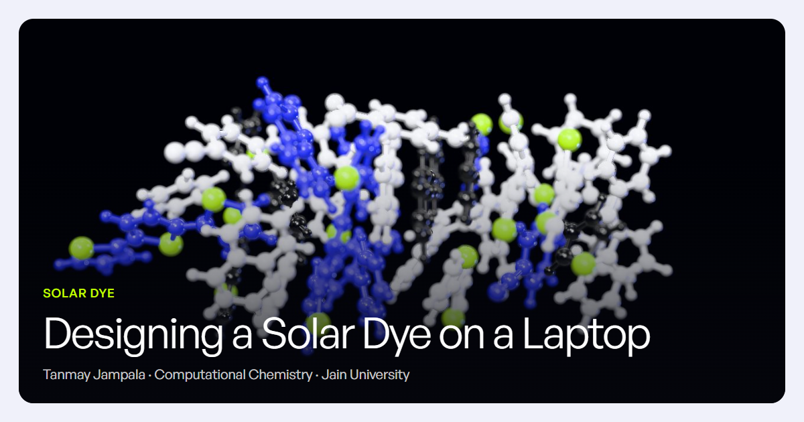

# Designing a Solar Dye on a Laptop

**Can one laptop screen a database of 130,831 molecules for a solar-cell dye, and what does it cost to find out?**

A computational chemistry project (Computational Chemistry 25BSCH01, Jain University, FET) by Tanmay Jampala.

**Website:** https://tanmay-jampala.github.io/solar-dye/
**Notebook:** https://tanmay-jampala.github.io/solar-dye/notebook/ (the executed notebook, rendered)

[](https://tanmay-jampala.github.io/solar-dye/)

---

## The question

A dye-sensitised solar cell needs a molecule whose band gap matches sunlight. Thermodynamics sets the target: by detailed balance, a single-junction cell under real sunlight converts at most **33.68 %** of the light, at a band gap of **1.34 eV** (the Shockley–Queisser limit).

The project asks how close cheap computation can get to that target, in eight steps:

| Part | What | Method |
|---|---|---|
| 0 | The data | QM9 (130,831 small molecules with B3LYP gaps) and HOPV15 (350 real organic photovoltaic dyes), downloaded and checksummed |
| 1 | The ceiling | Shockley–Queisser detailed balance on the ASTM G173-03 AM1.5G spectrum |
| 2 | HF vs B3LYP | Nine molecules optimised with Hartree–Fock and B3LYP/6-31G* in PySCF, compared with QM9 and experiment |
| 3 | The twist | Relaxed B3LYP torsion scan of bithiophene, 0–180° |
| 4 | Descriptors and filters | 11 RDKit descriptors, Lipinski's rule, and a five-rule dye-likeness filter of our own |
| 5 | The surrogate | Ridge, random forest and gradient boosting trained on QM9; a screen of all of QM9; the best hits checked with DFT |
| 6 | Quantum dots | The Brus equation for CdSe and PbS against experimental sizing curves |
| 7 | The cost of knowing | Time, energy, rupees and CO₂ of every calculation, the brute-force alternative, and the Landauer limit |

## What we found

- **The ceiling:** 33.68 % at 1.34 eV, matching the published value (Rühle 2016).
- **Methods:** Hartree–Fock gaps are far too large. B3LYP agrees with QM9's own values for the molecules QM9 contains. Both show the gap shrinking as conjugation grows.
- **Twist:** bithiophene's lowest energy is at 160°. Flattening it costs 3.9 meV, which is 0.15 kT at room temperature, while twisting to 90° opens the gap by 1.605 eV.
- **Surrogate:** gradient boosting predicts the QM9 gap with a test MAE of 0.226 eV (R² 0.942).
- **Screen:** 130,831 molecules → 13,087 pass the dye filter → 81 predicted below 4.0 eV → top 10 → 3 verified with B3LYP.
- **Cost:** the whole project used 0.198 kWh (₹1.15, 144 g CO₂). Running B3LYP on all of QM9 on this laptop would take 1.33 years and 525 kWh. The ML screen of the same set took 2.68 s in the recorded run.

### Honest negatives (kept on purpose)

- **QM9 cannot reach the target.** The closest prediction is 3.10 eV, 1.76 eV short, and all 10 of the top 10 hits were already in the training set.
- **The models fail on real dyes.** On HOPV15 (out of domain) the mean errors are 3.61 eV (gradient boosting), 3.10 eV (random forest) and 12.01 eV (Ridge).
- **My prediction was wrong.** I expected B3LYP to underestimate the optical gap; it overestimates it, by 0.757 eV for thiophene.
- **CdSe cannot reach the target.** Its bulk gap is already above 1.34 eV, and confinement only raises it.
- **Brus is off by a factor of 2.00 for PbS.** It puts the target at a radius of 3.00 nm, against 1.50 nm from the experimental sizing curve.

Three inputs come from secondary sources and are flagged wherever they appear: the Becker 1996 optical gaps, the page references for the quantum-dot parameters, and the BESCOM electricity tariff.

Every number above is in [`results/results.json`](results/results.json). It is checked by 51 self-checks, all passing, which the [website's checks page](https://tanmay-jampala.github.io/solar-dye/checks/) lists in full.

## Repository layout

| Path | What it is |
|---|---|
| `src/` | The pipeline: one module per part (`spectra`, `quantum`, `torsion`, `descriptors`, `model`, `quantum_dots`, `energy`), plus `pipeline.py`, `figures.py` and `reproduce.py` |
| `results/results.json` | Every result, its provenance and the self-checks: the single source of truth |
| `results/figures/` | 16 figures, each as a 300 dpi PNG and an SVG (there is no fig08) |
| `results/web_qm9_points.json` | Every QM9 row's gap and furthest screening stage, used by the website |
| `notebook/solar_dye.ipynb` | The executed notebook, generated by `src/build_notebook.py` (do not hand-edit) |
| `data/processed/` | The cleaned QM9 and HOPV15 tables |
| `cache/quantum/`, `cache/torsion/` | The finished HF/DFT results (about 4.4 h of computation), committed so a clone never re-runs them |
| `site/` | The website: see [`site/README.md`](site/README.md) |
| `py.sh`, `environment.yml`, `requirements.txt` | Environment and launcher |

## Reproduce the science

The project ran on one laptop (Intel Core i5-10500H, 6 cores, 16 GB RAM) with Python 3.11, PySCF 2.15.0, RDKit 2026.9.2 and scikit-learn 1.9.1. Exact versions are in `environment.yml` and in `results.json → environment`.

1. Create the environment (on Windows, PySCF installs only from conda-forge):

   ```bash
   micromamba create -n solar-dye -f environment.yml
   ```

2. Rebuild everything with one command:

   ```bash
   ./py.sh -m src.reproduce
   ```

   It downloads the raw data (about 60 MB) and verifies every checksum, runs any HF/DFT calculation that is not cached (none, on a fresh clone), then rebuilds and executes the notebook. It prints `51/51 checks passed` and exits 1 if any check fails.

`py.sh` looks for the environment in `$HOME/micromamba/envs/solar-dye`; set `SOLAR_DYE_ENV` to use another location. The random seed is 42 throughout.

Measured timings (and the figures and totals made from them) are re-measured on every run, so they change slightly; everything else reproduces exactly. `results.json → git_commit` records the commit the pipeline ran on, as it was named before this repository's history was cleaned for publication (it corresponds to `0e1d0b3`).

## The website

`site/` holds a static Astro site with WebGL scenes. Every number on it is read from `results/results.json` at build time and formatted by one function with a precision rule per key. A build-time lint fails on any number in the page text that is not bound to a key. The site has:

- a home page that walks the story with the honest negatives in the main scroll;
- one page per part, with interactive versions of the figures;
- an in-browser Ridge predictor, labelled as the weakest model;
- a checks page.

How it was verified (number audit, accessibility, performance) is in [`site/VERIFICATION.md`](site/VERIFICATION.md) and [`site/NUMBER_AUDIT.md`](site/NUMBER_AUDIT.md). Building and publishing it is described in [`site/README.md`](site/README.md).

## Data, fonts and licences

- **QM9:** Ramakrishnan et al., *Sci. Data* 1, 140022 (2014). CC0. Obtained from the DeepChem/MoleculeNet mirror, together with the authors' list of uncharacterized molecules from figshare.
- **HOPV15:** the Harvard Organic Photovoltaic Dataset, Lopez et al., *Sci. Data* 3, 160086 (2016), revision 2. CC BY 4.0. The cleaned table in `data/processed/hopv_clean.csv` is derived from it.
- **Solar spectrum:** the ASTM G173-03 AM1.5G table, as redistributed with pvlib-python v0.11.0.
- **Literature values** (optical gaps, quantum-dot parameters, sizing curves, tariff, grid emission factor): cited where they are used, in `results.json` and on the website.
- **Fonts:** General Sans (Indian Type Foundry, ITF Free Font License) is self-hosted by the website but not included here; [`site/src/assets/fonts/README.md`](site/src/assets/fonts/README.md) explains how to get it. IBM Plex Mono is under the SIL Open Font License.
- **Software:** the website uses three.js, GSAP, Lenis, Astro and KaTeX. The science uses PySCF, RDKit, scikit-learn and geomeTRIC.
